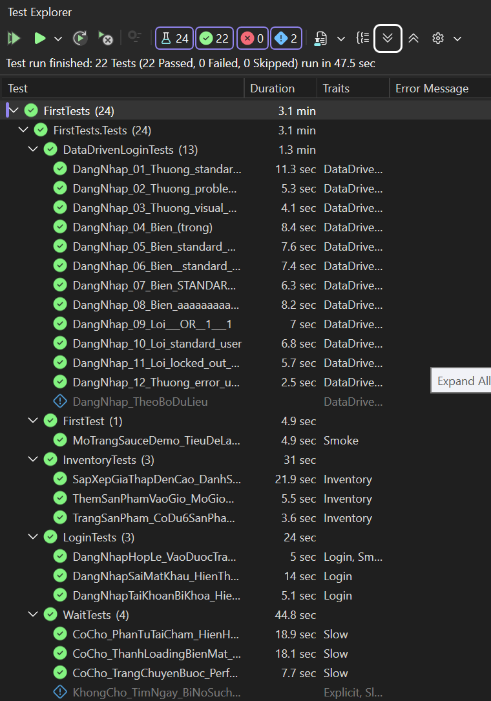
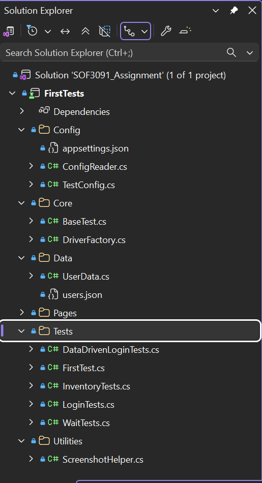
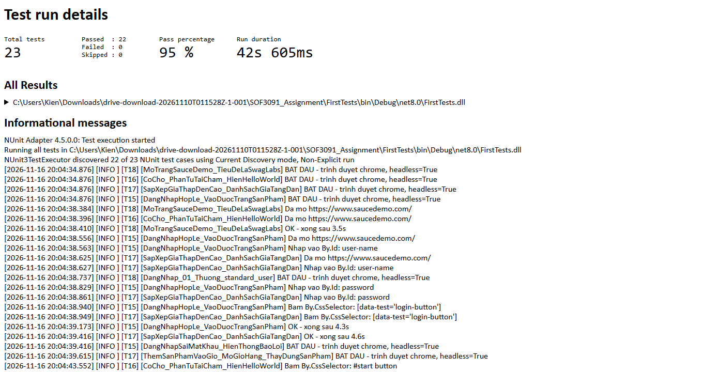

# SOF3091 Assignment - Selenium với .NET

Đây là bài assignment môn Kiểm thử nâng cao cùng AI (.NET). Mình viết test tự động cho trang https://www.saucedemo.com/ bằng C#, NUnit và Selenium, chuyển sang Page Object Model, rồi dựng thành framework nhỏ có file cấu hình, dữ liệu test ngoài, ghi log, báo cáo và chạy song song.

Hiện tại repo đã làm đến Y6. Từ Y7 trở đi mình chưa làm.

## Dùng gì

- .NET 8, C#
- NUnit 3.14
- Selenium WebDriver + Selenium.Support 4.52 (Selenium Manager tự tải driver nên không cần cài tay)
- Microsoft.Extensions.Configuration để đọc `appsettings.json`
- Google Chrome (chạy được cả Edge, chỉ cần đổi 1 chữ trong file cấu hình)
- Visual Studio, Git

## Cấu trúc

```
SOF3091_Assignment/
├── SOF3091_Assignment.slnx
├── FirstTests/
│   ├── AssemblyInfo.cs   bật chạy song song
│   ├── Config/           appsettings.json, TestConfig, ConfigReader
│   ├── Core/             BaseTest (mở/đóng trình duyệt, ghi log), DriverFactory
│   ├── Data/             users.json (dữ liệu đăng nhập), UserData
│   ├── Pages/            BasePage, LoginPage, InventoryPage, CartPage, DynamicLoadingPage
│   ├── Tests/            FirstTest, LoginTests, DataDrivenLoginTests, InventoryTests, WaitTests
│   └── Utilities/        Log, ScreenshotHelper
├── screenshots/          ảnh minh chứng
├── evidence/             output gốc, file log, báo cáo .trx/.html của lần chạy
└── Bao_cao_Assignment_Y1-Y6.docx
```

Locator chỉ nằm trong thư mục Pages. Các file test không có `[SetUp]`, `[TearDown]`, `new ChromeDriver()` hay URL viết cứng, mấy việc đó do `BaseTest` và `appsettings.json` lo.

## Cách chạy

Máy cần có .NET SDK 8 trở lên, Chrome và Internet.

```bash
git clone https://github.com/kiennctb01907/SOF3091-Assignment.git
cd SOF3091-Assignment
dotnet build
dotnet test
```

Nếu dùng Visual Studio thì mở file `SOF3091_Assignment.slnx`, build rồi vào Test Explorer bấm Run All.

Mặc định test chạy Chrome ở chế độ headless (không hiện cửa sổ). Muốn xem trình duyệt chạy thì sửa `"Headless": false` trong `FirstTests/Config/appsettings.json`. Muốn chạy Edge thì sửa `"Browser": "edge"`.

Một số lệnh hay dùng:

```bash
# chỉ chạy nhóm Smoke
dotnet test --filter "Category=Smoke"

# bỏ qua nhóm chạy chậm
dotnet test --filter "Category!=Slow"

# xuất báo cáo .trx và .html vào thư mục TestResults
dotnet test --logger "trx;LogFileName=ketqua.trx" --logger "html;LogFileName=baocao.html" --results-directory TestResults

# chạy tuần tự để so thời gian
dotnet test -- NUnit.NumberOfTestWorkers=0
```

Có một test cố ý cho rớt là `KhongCho_TimNgay_BiNoSuchElement` (để chứng minh lỗi không chờ ở Y3). Mình gắn `[Explicit]` nên Run All sẽ không chạy nó. Muốn xem thì chạy riêng:

```bash
dotnet test --filter "Name=KhongCho_TimNgay_BiNoSuchElement"
```

Nhật ký chạy test nằm ở `FirstTests/bin/Debug/net8.0/logs/test-run.log`, ảnh chụp khi test rớt nằm ở `FirstTests/bin/Debug/net8.0/failed-screenshots/`.

## Đã làm gì

- **Y1:** tạo project NUnit, cài Selenium, viết test mở saucedemo và kiểm tra tiêu đề "Swag Labs". Commit theo Conventional Commits.
- **Y2:** test đăng nhập (đúng, sai mật khẩu, tài khoản bị khóa) và luồng thêm sản phẩm vào giỏ rồi mở giỏ. Locator dùng id hoặc data-test, không dùng XPath.
- **Y3:** bỏ hết chờ cố định, chỉ dùng `WebDriverWait`. Xử lý phần tử tải chậm, thanh Loading và trang chuyển bước. Chạy 3 lần liên tiếp đều xanh.
- **Y4:** tách `BasePage` và các Page, locator để `private readonly By`, test không còn locator nào. Thử đổi locator nút Login thì chỉ sửa đúng 1 dòng.
- **Y5:** đưa URL, trình duyệt, timeout, headless ra `appsettings.json`; `DriverFactory` tạo Chrome/Edge/Firefox; `BaseTest` lo mở và đóng trình duyệt. Dữ liệu đăng nhập nằm trong `Data/users.json` (12 bộ: ca thường, ca biên, ca lỗi), chạy qua `[TestCaseSource]`. Thêm 1 bộ vào JSON là có thêm 1 ca test, không sửa code.
- **Y6:** lớp `Log` ghi từng bước kèm thời gian, mức độ (INFO/ERROR), luồng và tên test; gắn `[Category]`; xuất báo cáo `.trx` và `.html`; tự chụp ảnh khi test rớt; bật chạy song song theo lớp test.

## Chạy song song và vì sao không bị đụng nhau

Trong `AssemblyInfo.cs` mình bật `[assembly: Parallelizable(ParallelScope.Fixtures)]` với 4 luồng. Lớp `DataDrivenLoginTests` có nhiều ca nhất nên mình cho thêm `FixtureLifeCycle(InstancePerTestCase)` để các ca trong lớp này cũng chạy song song được.

Framework không bị đụng nhau khi chạy song song vì `driver` trong `BaseTest` là field thường, không phải `static`. Mỗi lớp test (hoặc mỗi ca, với lớp data-driven) có đối tượng riêng nên có trình duyệt riêng. Cấu hình chỉ đọc một lần bằng `Lazy` và không bị sửa khi chạy, còn lớp `Log` có khóa khi ghi file.

Thời gian đo trên máy mình (22 test, Chrome headless):

| Cách chạy | Thời gian | Kết quả |
|---|---|---|
| Tuần tự | khoảng 84 giây | 22/22 đạt |
| Song song theo lớp | khoảng 63 giây | 22/22 đạt |
| Song song theo lớp + các ca data-driven | 40 - 52 giây | 22/22 đạt |

## Ảnh

Test Explorer khi chạy song song (22 test Passed trong 47.5 giây):



Cấu trúc thư mục trong Solution Explorer:



Báo cáo HTML sinh ra từ `dotnet test`:



Báo cáo đầy đủ nằm ở file [Bao_cao_Assignment_Y1-Y6.docx](Bao_cao_Assignment_Y1-Y6.docx).
