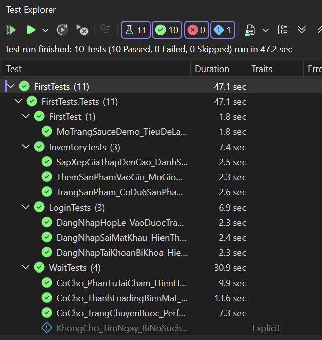
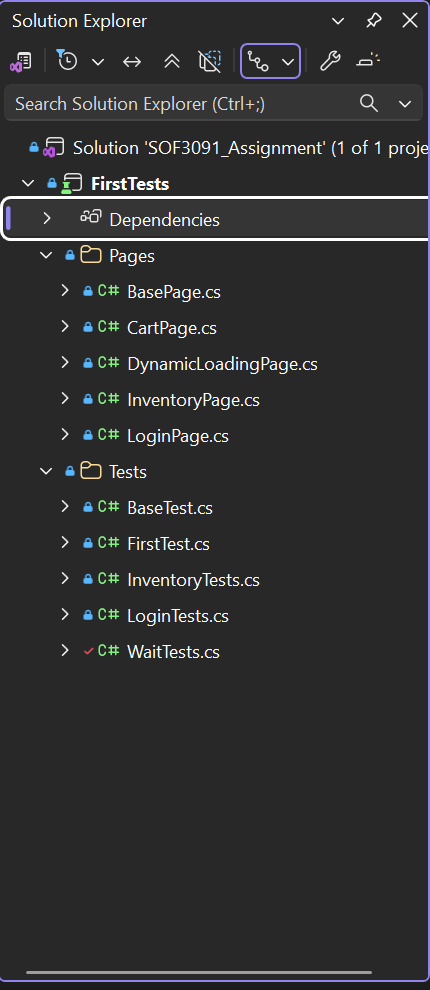

# SOF3091 Assignment - Selenium với .NET

Đây là bài assignment môn Kiểm thử nâng cao cùng AI (.NET). Mình viết test tự động cho trang https://www.saucedemo.com/ bằng C#, NUnit và Selenium, sau đó chuyển sang Page Object Model cho gọn.

Hiện tại repo mới làm đến Y4 (môi trường, luồng Selenium, chờ tường minh, POM). Từ Y5 trở đi mình chưa làm.

## Dùng gì

- .NET 8, C#
- NUnit 3.14
- Selenium WebDriver + Selenium.Support 4.52 (Selenium Manager tự tải ChromeDriver nên không cần cài tay)
- Google Chrome
- Visual Studio, Git

## Cấu trúc

```
SOF3091_Assignment/
├── SOF3091_Assignment.slnx
├── FirstTests/
│   ├── FirstTests.csproj
│   ├── Pages/        BasePage, LoginPage, InventoryPage, CartPage, DynamicLoadingPage
│   └── Tests/        BaseTest, FirstTest, LoginTests, InventoryTests, WaitTests
├── screenshots/      ảnh minh chứng
├── evidence/         output gốc của các lệnh dùng trong báo cáo
└── Bao_cao_Assignment_Y1-Y4.docx
```

Locator chỉ nằm trong thư mục Pages, còn Tests chỉ gọi các hàm như `DangNhap`, `SapXep`, `LayDanhSachGia`.

## Cách chạy

Máy cần có .NET SDK 8 trở lên, Chrome và Internet.

```bash
git clone https://github.com/kiennctb01907/SOF3091-Assignment.git
cd SOF3091-Assignment
dotnet build
dotnet test
```

Nếu dùng Visual Studio thì mở file `SOF3091_Assignment.slnx`, build rồi vào Test Explorer bấm Run All.

Có một test cố ý cho rớt là `KhongCho_TimNgay_BiNoSuchElement` (để chứng minh lỗi không chờ ở Y3). Mình gắn `[Explicit]` nên Run All sẽ không chạy nó. Muốn xem thì chạy riêng:

```bash
dotnet test --filter "Name=KhongCho_TimNgay_BiNoSuchElement"
```

Mấy test tải chậm dùng trang https://practice.expandtesting.com/dynamic-loading/2 nên mạng yếu có thể chạy hơi lâu.

## Đã làm gì

- **Y1:** tạo project NUnit, cài Selenium, viết test mở saucedemo và kiểm tra tiêu đề "Swag Labs". Commit theo Conventional Commits.
- **Y2:** test đăng nhập (đúng, sai mật khẩu, tài khoản bị khóa) và luồng thêm sản phẩm vào giỏ rồi mở giỏ. Locator dùng id hoặc data-test, không dùng XPath.
- **Y3:** bỏ hết chờ cố định, chỉ dùng `WebDriverWait`. Xử lý phần tử tải chậm, thanh Loading và trang chuyển bước. Chạy 3 lần liên tiếp đều xanh.
- **Y4:** tách `BasePage` và các Page, locator để `private readonly By`, test không còn locator nào. Thử đổi locator nút Login thì chỉ sửa đúng 1 dòng.

## Ảnh

Test Explorer sau khi chạy (10 test Passed):



Thư mục Pages và Tests trong Solution Explorer:



Báo cáo đầy đủ nằm ở file [Bao_cao_Assignment_Y1-Y4.docx](Bao_cao_Assignment_Y1-Y4.docx).
